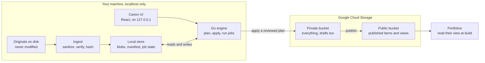

> Decisions made after this doc was written are recorded in `docs/plans/M0-M1.md` (D1 to D16, approved 2026-10-27). Where the two differ, the plan wins.

# Canon: Content Pipeline Design Doc

Oct 27, 2026 · Nicole

## Summary and key decisions

Canon (working name) makes one GCS-backed manifest the single source of truth for all of my content (art, photos, music, video, writing, software projects), managed through a local-only app and read by every portfolio. It runs on my machine, binds to localhost, and is never served on the internet in v1.

- **Local-only for v1.** The only thing deployed is what already is: the portfolios, which read a public bucket. The management app never needs to be reachable from outside, so there is no auth surface to defend.
- **No OAuth in v1.** The app talks to GCP with my local `gcloud` Application Default Credentials. Google OAuth solves a problem (proving who is at the keyboard of a remote server) that a localhost app does not have.
- **Cross-platform later, without exposure.** Phone access comes from putting the machine on a private Tailscale network, not from the public internet. A hosted version, if ever needed, goes behind Google Identity-Aware Proxy rather than hand-rolled auth (see Security).
- **Two buckets.** A private bucket holds everything; a public bucket holds only what is published. Publishing is a projection, so drafts and private notes can never leak by URL.
- **Five load-bearing ideas:** manifest is the truth, content-addressed blobs, derived assets as versioned jobs, plan-then-apply, and privacy sanitization before anything leaves the machine.

## Goals and non-goals

**Goals**

- Add any piece of content once (drag in a file, fill a few fields) and have it show up correctly everywhere it belongs.
- Every sync is safe to run twice: a second run with no changes does nothing and says so.
- Nothing changes in the cloud without a reviewed plan first.
- No photo, video or audio ever leaves my machine with location or device metadata.
- Portfolios become thin readers of their own resolved view, replacing the hand-maintained `content.ts` and the watcher sync that feeds the 3D world.
- The core engine is a Go library, so it can later become a module of my Wails toolbox app.
- Deterministic outputs: same inputs and pipeline version produce byte-identical manifests, views and derived asset keys.

**Non-goals for v1**

- Multi-user access, sharing, or roles.
- Public hosting of the management app.
- Generative AI anywhere in the pipeline. Classical tooling (ffmpeg, exiftool, image libraries) does all processing.
- A CDN or custom domain for assets (public GCS URLs are fine to start).
- Mobile UI.

## Architecture and stack

One Go binary holds the engine, the CLI, and the local server for the UI; the only path to the cloud is the engine applying a plan.



Ingest and the UI only ever touch local state. The engine is the single writer to both buckets, and portfolios only read the public one.

| Layer | Choice | Why |
| --- | --- | --- |
| Engine and CLI | Go, `cloud.google.com/go/storage`, cobra | Matches my stack, ships as one binary, importable later by the Wails toolbox |
| UI | React, TypeScript, Vite, embedded with `go:embed` | No separate server or install step |
| Local state | SQLite via `modernc.org/sqlite` | Pure Go, no CGO, easy cross-compiling |
| Media tools | ffmpeg, exiftool, qpdf (shelled out) | Proven, and deterministic per pinned version |
| Types | JSON Schema with Go and TypeScript/Zod codegen | One definition for engine and portfolios |
| Tests | `go test`, Vitest, `fake-gcs-server` | No test touches a real bucket |

```
canon/
  cmd/canon/     CLI entry (plan, apply, ingest, serve, gc, doctor, import)
  engine/        ingest, diff, plan, apply, jobs, views (importable library)
  recipes/       one file per recipe, each with its version
  api/           local HTTP API and openapi.yaml
  schema/        manifest and view schemas, plus codegen
  ui/            React app
  client/        @canon/client package for portfolios
  scripts/       idempotent bucket provisioning
  testdata/      synthetic fixtures only, including fake GPS-tagged photos
```

## Manifest schema

One rule decides where anything shows: an item appears on a surface only if it is published and has a placement for that surface. Facts about a work live once on the item; how a particular site shows it lives on that site's placement.

**What the existing configs taught us**

- The same work was described several ways and drifted. RPG Quests was `videogamequest`, `vgq-desktop` and `vgq-mobile`, with two different URLs and an outdated description in the old showroom config.
- One work often appears more than once on a surface: Tierlistify as two phone previews.
- Media is not addressable, so unrelated displays reused one placeholder screenshot.
- Surface-only settings sit in the shared shape: window sizes, light colors, iframe viewports, internal routes.
- Some values cannot be JSON as written: a React component (`BatchAnalyzerDescription`) and a free-text date ("Sometime in like Oct 2025").
- `hide: true` in a public repo still publishes drafts and TODO notes.

**The model: four layers on each item**

| Layer | Holds | Example |
| --- | --- | --- |
| Item | Facts true everywhere | title, summary, why, date, status, tech, links |
| Assets | Media files by role | thumbnail, phone screenshot, demo GIF, full-res artwork, audio |
| Copy overrides | Per-surface wording | software portfolio calls the 3D site "Nicole's World" |
| Placements | Presence on a surface plus that surface's settings | desktop window size, showroom order and light color, portfolio preview |

```json
{
  "id": "01JB7Z...",
  "slug": "rpg-quests",
  "aliases": ["videogamequest"],
  "kind": "project",
  "visibility": "public",
  "title": "RPG Quests",
  "summary": "Write a journal entry and get it back as video game quests.",
  "why": "I wanted journaling to feel more like playing a game.",
  "date": { "value": "2025-06" },
  "status": "operational",
  "category": "ai-productivity",
  "tech": ["typescript", "react", "llm-apis"],
  "tags": ["gamification", "journaling"],
  "facts": { "embeddable": true },
  "links": [
    { "rel": "live", "url": "https://rpg-quests.netlify.app/" }
  ],
  "assets": [
    { "role": "thumbnail", "blob": "sha256:9f2c..." },
    { "role": "screenshot", "viewport": "desktop", "blob": "sha256:41aa..." },
    { "role": "screenshot", "viewport": "phone", "blob": "sha256:c07e..." }
  ],
  "copy": {},
  "placements": [
    { "surface": "nickel-desktop", "config": { "open": "new-tab" } },
    { "surface": "software-portfolio", "order": 40,
      "config": { "preview": { "kind": "phones", "urls": ["https://rpg-quests.netlify.app/"] } } },
    { "surface": "holodeck-showroom", "order": 12,
      "config": { "viewport": "desktop", "light": "#ff00ff" } }
  ],
  "private": { "notes": "Old previews pointed at videogamequest.me, which lapsed. Repointed." }
}
```

**Rules**

- **Surfaces are registered, each with its own config schema.** The manifest has a `surfaces` table (`nickel-desktop`, `software-portfolio`, `design-portfolio`, `art-portfolio`, `holodeck-showroom`, `holodeck-art-room`, ...). Each declares a JSON Schema for its placement `config`, so a bad value or a missing viewport fails at plan time. A new portfolio is a new surface, never a change to the item schema.
- **Placement presence is the only on/off switch.** No `surfaces` array and no per-surface hide flags. A placement can carry `hidden: true` to park it without losing its settings.
- **Copy resolves field by field:** placement `copy`, then `copy[surface]`, then the item. Placement-level copy covers two placements on one surface needing different titles (a desktop and a phone version of the same app).
- **Assets are requested by role and viewport,** for example "screenshot, phone". The client falls back to the thumbnail, then a generated placeholder. Shared placeholder files go away.
- **Taxonomy lives in the manifest:** categories, tech, mediums, tags and viewports as slug, label and icon. Vocabularies become editable in Canon instead of in `taxonomy.ts`, and an unknown slug fails validation.
- **Viewports are named presets** (`desktop` 1200x800, `phone` 393x852, `phone-small` 375x667, `video` 16:9), replacing per-display width and height pairs.
- **3D layout stays in site code.** The showroom lays out from its view in order, so its placement carries only order, viewport and light color. No coordinates in the manifest: rearranging the room is a code change, and choosing what goes in it is a content change.
- **Collections are items** (`kind: collection`) with an ordered `members` list. A piece can belong to several: a left-handed sketch sits in both Sketches and Left-Handed Art. Galleries render members in order.
- **Kinds:** `project`, `artwork`, `photo`, `track`, `video`, `writing`, `collection`, `experience` (a place inside a site, like Art Room). Each kind adds a typed `facts` block, such as dimensions and medium for artwork or duration, BPM and key for tracks.
- **Dates** are `{ value, label? }`: an ISO partial (`2025`, `2025-10`, `2025-10-03`) for sorting, plus an optional display label for jokes like "Sometime in like Oct 2025".
- **Rich descriptions** are markdown blobs. When markdown is not enough, `richDescription.component` names a key that a site maps to its own React component; the component stays in that site's code.
- **Featured and order are per placement,** replacing the one global `featured` list.
- **`private` exists only in the private manifest.** The public projection is an allowlist, so notes and TODOs can never publish. This replaces `hide: true` in a public repo.
- **Not content:** About, Contact and Settings windows stay in Nickel Tools code. They are app chrome, not things another portfolio would show.
- **IDs:** ULID, never changes. `slug` can change; `aliases` keep old ids, which also drives the migration mapping from `content.ts`.
- **Determinism:** items sorted by `id`, keys sorted, 2-space indent, trailing newline, validated on every load and write.

**Surface views**

The 3D world already reads a JSON file synced from `content.ts`: one surface's fully resolved view, with overrides merged, thumbnails turned into absolute URLs, and previews resolved. Canon makes that pattern the norm instead of each site reimplementing the resolver.

- **Apply writes one view per surface** to the public bucket (`views/<surface>.json`) next to `manifest.json`. A view is flat and final: copy resolved, assets as URLs, ordering applied, hidden placements dropped. Sites read their view and do no merging, so the resolver logic in `content.ts` (`detailsFor`, `toPortfolioProject`) moves into Canon once.
- **Each view has its own schema and version,** owned by its surface and designed fresh in the overhaul. The `content.ts` watcher sync is retired; nothing watches Nickel Tools anymore.
- **Views are deterministic outputs** and fall under the idempotency test: an unchanged manifest produces byte-identical views and a plan that writes nothing.
- **Site-wide `profile`** (name, headline, summary, links) is a top-level manifest block, not an item. Each view includes the parts it needs.
- **`embeddable` is an item fact.** The Circle cannot run in an iframe, which today is repeated as `preview: "none"` per surface. Recorded once, every iframe-based surface swaps to a screenshot automatically.
- **Owned domains are declared.** The manifest lists domains I control. Any preview or embed URL outside that list fails validation, and any link outside it is flagged in the plan. A lapsed domain like `videogamequest.me` can be bought by someone else, and an iframe would then show their page inside my portfolio.
- **Thumbnails live in the Nickel Tools repo today** (`nickeltools.dev/project-screenshots/...`). Migration imports them as assets, so no view depends on another site's public folder.

**Open schema questions**

- [ ] How does the holodeck art API list individual pieces (by folder, or with metadata)? Art collections carry no pieces today, so artwork items import from there.
- [ ] Should MidiMuse and Smart Piano merge into one item?
- [ ] Is `saucedog.art` a surface Canon feeds, or an archived site that only gets linked?
- [ ] Which domains go on the owned list (nicolebelovoskey.com, nickeltools.dev, saucedog.art and their subdomains, netlify.app sites)?

## Storage layout

Two buckets, both with uniform bucket-level access and object versioning on: a private one that holds everything, and a public one that holds only published items. Files are named by the SHA-256 of their sanitized bytes, so uploading the same file twice is a no-op by construction.

| Bucket | Path | What lives there | Cache-Control |
| --- | --- | --- | --- |
| private | `blobs/sha256/ab/cd/<hash>.<ext>` | Every sanitized source file, drafts included | n/a (not public) |
| private | `derived/<jobkey>/<file>` | Every derived output | n/a |
| private | `manifest/manifest.json` | The full manifest, the real source of truth | n/a |
| private | `manifest/history/<utc>-<hash>.json` | Snapshot written on every apply, for rollback | n/a |
| public | `blobs/...` and `derived/...` | Copies of only the published items' files, same paths | `public, max-age=31536000, immutable` |
| public | `manifest.json` | The public projection: drafts removed, private fields stripped | `public, max-age=60` |
| public | `views/<surface>.json` | One flat, resolved view per surface, read by that site | `public, max-age=60` |

- **Why two buckets:** an unguessable hash URL in a public bucket is still public. Keeping drafts in a bucket with no public access makes leaks impossible rather than unlikely.
- **Immutable paths:** a blob path never changes meaning, so it can be cached forever. Only manifests and views are short-lived.
- **Integrity metadata:** every object carries `x-goog-meta-sha256`, so the remote state can be checked without downloading anything (GCS's own crc32c is verified on upload too).
- **Concurrency guard:** manifest writes use GCS generation preconditions (`ifGenerationMatch`). If the manifest changed since the plan was made, apply refuses instead of overwriting.
- **Bucket names and region:** to be decided (open question). Provisioning lives in a repo script using `gcloud storage`, idempotent like everything else.

## Ingest and privacy sanitization

Every file is sanitized before it is hashed, so the hash, the blob and everything downstream only ever refer to clean bytes. An unsanitized file can never reach a bucket because there is no code path that uploads anything not produced by the sanitizer.

1. **Detect** the real type from file contents (magic bytes), not the extension.
2. **Sanitize** losslessly:
    - Images: `exiftool -all= -tagsFromFile @ -ColorSpaceTags -Orientation` keeps color profile and orientation, drops everything else (GPS, camera serial, software, timestamps).
    - Video and audio: `ffmpeg -map_metadata -1 -map_chapters -1 -c copy` (no re-encode).
    - PDFs: `exiftool -all:all=` plus a qpdf rewrite so the old metadata is not recoverable from incremental updates.
3. **Verify** by re-reading the output with exiftool and failing the ingest if any GPS, serial, or owner-name tag survives. This check is a hard gate, not a warning.
4. **Hash** the sanitized bytes (SHA-256) and store them in the local blob cache.
5. **Extract facts** (dimensions, duration, sample rate) into the item's `facts`.
6. **Draft** a manifest item with `visibility: draft`, ready for editing in the UI.

Originals stay where they were on disk; Canon never modifies or deletes them. The local blob cache lives in a configurable folder on the Windows machine (WSL side), since the MacBook is short on disk.

## Derived assets as jobs

Each derived asset comes from a named, versioned recipe, and its storage key is a hash of exactly what produced it. Bump a recipe's version and only that recipe's outputs rebuild; touch nothing and nothing rebuilds.

```
jobkey = sha256(sourceSha256 + recipeName + recipeVersion + canonicalJSON(params))
```

| Recipe | Applies to | Output |
| --- | --- | --- |
| `thumb@v1` | art, photo, video poster | WebP at 320, 800, 1600 px wide |
| `lqip@v1` | art, photo | Tiny blurred placeholder, inlined in the manifest |
| `palette@v1` | art, photo | Dominant colors, stored in `facts` |
| `poster@v1` | video | Still frame for previews |
| `web@v1` | video | H.264 MP4, CRF 23, `-preset veryfast`, faststart |
| `preview@v1` | music | 128 kbps MP3 plus a 30-second clip |
| `peaks@v1` | music | Waveform peaks JSON for drawing players |

- **Job state** lives in a local SQLite file (`modernc.org/sqlite`, pure Go): pending, running, done, failed, with attempt counts and the last error.
- **Idempotent by key:** before running, check whether `derived/<jobkey>/` already exists remotely with matching checksums. If it does, mark done and skip.
- **Atomic outputs:** write to a temp folder, verify, then upload. A crashed job leaves no partial files behind under the real key.
- **Retries** with exponential backoff and jitter for transient errors (network, 429, 5xx). Tool errors (bad input file) fail fast and surface in the UI.
- **Worker pool** sized from CPU count, with a separate cap of one or two concurrent ffmpeg jobs so video encodes do not starve everything else.
- **Pinned tool versions:** `canon doctor` records ffmpeg and exiftool versions. A tool upgrade that changes output means bumping the recipe version, which is what makes outputs reproducible.

## Plan and apply

Sync works like Terraform: `plan` compares desired state with what is actually in the buckets and prints an ordered list of operations; `apply` executes a saved plan and nothing else. The diff is a pure function, which makes it the most testable part of the system.

```
diff(desired: Manifest + Recipes, actual: RemoteListing) -> []Op
```

- **Desired state:** the local working manifest plus the recipe registry, expanded into every blob, derived output, public copy and view that should exist.
- **Actual state:** a listing of both buckets (names, sizes, `sha256` metadata, generations). No downloads.
- **Operation types:** `upload-blob`, `run-job`, `publish-copy`, `unpublish`, `write-manifest`, `write-public-manifest`, `write-view`, `orphan` (reported only).
- **Saved plans:** `canon plan -o plan.json` writes the ops plus the manifest generation it was computed against. `canon apply plan.json` refuses if that generation has moved.
- **Ordering:** blobs and jobs first, public copies second, manifests and views last. If apply dies halfway, the old manifest still points only at files that exist, and a rerun picks up where it stopped.
- **Deletes are opt-in.** Orphans are listed, never removed, unless I run `canon gc --apply`. GC moves objects to a 30-day soft-delete rather than destroying them.
- **The idempotency test is the definition of done:** after any successful apply, an immediate second `plan` must be empty.

Example plan output:

```
Plan: 3 to upload, 7 jobs, 2 to publish, 1 to unpublish, 0 orphaned
  + upload  blobs/sha256/9f/2c/9f2c...png         (night-market-study, 4.8 MB)
  + job     thumb@v1  night-market-study          -> derived/7a1e.../
  ~ publish night-market-study                     draft -> public
  - unpub   old-figure-sketch                      public -> draft
  ~ manifest  12 items changed (generation 41 -> next)
  ~ views     software-portfolio, art-portfolio
```

## Local management UI

The UI is a React and TypeScript app embedded in the Go binary and served by `canon serve` on `127.0.0.1`. It is a thin client over the engine's local HTTP API: every action it offers is also a CLI command, so nothing is UI-only.

**Screens**

- **Library:** a dense grid of every item with filters by kind, surface, visibility and tag. Thumbnails come from the local cache, so it works offline.
- **Item editor:** title, summary, date, tags, placements, copy overrides, alt text, links, credits. Typed `facts` shown read-only. Autosaves to the local working manifest only; nothing goes to the cloud from here.
- **Ingest:** drag files or a folder onto the window; shows each file moving through detect, sanitize, verify, hash, with a clear red stop if verification finds leftover metadata.
- **Plan review:** the plan rendered as a readable diff with thumbnails beside each change, and a single Apply button. This is the only button in the app that touches the cloud.
- **Jobs:** queue, progress, failures with the tool's error output, and a retry button.
- **Surface preview:** shows exactly what each portfolio will see after the next apply, by rendering its view.

**Design direction:** quiet and fast, built for scanning. Keyboard-first (`/` to search, `e` to edit, `p` to plan). Visual polish matters here, but function lands before ornament. The unified portfolio is where the high-intention visual work goes.

## Portfolio integration and migration

Portfolios read per-surface views through a small typed client package, `@canon/client`, generated from each view's schema. Today `content.ts` is the single source of truth for software.nicolebelovoskey.com, the Nickel Tools desktop OS, the design and art pages, and (through the watcher sync) the 3D world. Canon replaces it entirely.

- **Client package:** a typed loader per surface view, such as `loadView('software-portfolio')`, generated from each view's schema and validated with Zod. It fails loudly on a schema mismatch. Sites never touch the raw manifest.
- **Build-time first:** sites fetch their view at build time and bake it in, so a broken bucket can never break a live page. Runtime fetching is an option per site later.
- **No shim:** `content.ts`, `taxonomy.ts` and the watcher sync are retired in the overhaul. Each portfolio moves straight to its view, one site at a time.

**Migration, in order:**

1. `canon import content-ts <path>` turns every `content.ts` entry into a manifest item with the right kind, turning each surface, override and only-block into placements and copy overrides. Lapsed `videogamequest.me` URLs are rewritten to `rpg-quests.netlify.app`, and any URL outside owned domains is flagged for review.
2. `canon import bucket <gs://old-bucket>` lists the current art and media bucket, downloads each object, sanitizes, hashes, and creates draft items. It writes a map of old URL to new URL.
3. I review and publish in the UI.
4. Move each site to its view (3D world first, since it already reads a JSON file), then delete `content.ts` and the watcher.
5. Only after every site is moved: `canon gc` reports the old objects, and I delete them myself.

## Security model and future remote access

The threat model for v1 is small: the app is not reachable from the network, so the real risks are a malicious web page poking at the localhost server, leaked cloud credentials, and accidentally publishing something private. Each has a specific control.

| Risk | Control |
| --- | --- |
| A website I visit sends requests to `localhost` (CSRF, DNS rebinding) | Bind `127.0.0.1` only. Reject any request whose `Host` header is not `127.0.0.1` or `localhost`. Random per-launch token required on every API call. No CORS headers at all. |
| Leaked GCP key file | No key files. Use `gcloud auth application-default login`, impersonating a dedicated service account that only has Storage Object Admin on the two Canon buckets. |
| Private content published by mistake | Two buckets; public bucket written only by `apply`; public manifest and views are allowlist projections, so new private fields are excluded by default. |
| Location or device data leaks | Sanitize-then-verify gate in ingest (see above). |
| Lapsed or foreign domains embedded | Owned-domains list; previews and embeds outside it fail validation. |
| Destructive mistake | Object versioning, manifest history snapshots, opt-in GC with soft delete. |

**Repo hygiene:** the repo can be public, but these never get committed: real photos as fixtures (synthetic only), the local blob cache, the SQLite file, saved `plan.json` files (they list draft titles), and local config with bucket names (commit an example config instead). Start private; scan history before flipping public.

**Should it be deployed?** Not now. Local-only removes the whole auth problem, and the portfolios are the part that needs to be public anyway. When phone access starts to matter, the upgrade path is:

1. **Tailscale first.** Run `tailscale serve` on the desktop so the UI is reachable from my phone over my private network only. Nothing is on the public internet, and the code does not change.
2. **Hosted only if needed.** Cloud Run behind Google Identity-Aware Proxy, restricted to my Google account. That gives Google sign-in without writing any OAuth code, which is the convenient part of OAuth without the risky part.

## Testing and correctness

The properties I care about (idempotent, deterministic, fault tolerant, private) each get a test that would fail if the property broke. Integration tests run against `fake-gcs-server` in Docker, so no test ever touches a real bucket.

| Property | Test |
| --- | --- |
| Idempotent | Apply a plan, then plan again: the second plan must be empty. Run this after every integration scenario. |
| Deterministic | Build the manifest and views twice from the same fixtures: byte-identical output. Same for job keys. |
| Correct diff | Table-driven unit tests on the pure `diff` function, plus golden-file tests for plan output. |
| Fault tolerant | Inject failures (kill mid-upload, return 503s, crash a job) and assert a rerun converges to the same end state. |
| Concurrency safe | Change the remote manifest between plan and apply: apply must refuse. |
| Private | Synthetic fixture photos with GPS, serials and owner tags; assert none survive sanitize, and that an injected sanitizer failure blocks ingest. |
| Public projection | Assert drafts and private fields never appear in the public manifest, any view, or the public bucket. |
| Owned domains | A preview URL on a non-owned domain fails validation. |

`canon doctor` checks the environment before anything runs: ffmpeg, exiftool and qpdf present with recorded versions, credentials working, buckets reachable, local cache writable.

## Milestones and build order

M0 and M1 are sequential foundations; after M1, the engine, the jobs, and the UI can be built in parallel by separate agents against the shared schema and API contract.

1. **M0 Scaffold:** monorepo, Go module, Vite React app embedded via `embed`, config file, `canon doctor`, idempotent bucket provisioning script, CI running tests.
2. **M1 Schema:** manifest and view JSON Schemas, generated Go and TypeScript types, validation, deterministic serializer, `@canon/client` skeleton. Everything else depends on this.
3. **M2 Ingest:** detect, sanitize, verify gate, hash, local blob cache, draft items. Privacy fixtures and tests.
4. **M3 Plan and apply (blobs + manifest only):** remote listing, pure diff, saved plans, generation preconditions, history snapshots, the idempotency test.
5. **M4 Derived jobs:** recipe registry, job keys, SQLite queue, worker pool, retries, the seven v1 recipes.
6. **M5 Publish:** public projection, public bucket copies, unpublish, public manifest, per-surface views.
7. **M6 UI:** library, editor, ingest, plan review, jobs, surface preview.
8. **M7 Migration:** `import content-ts`, `import bucket`, owned-domain check, 3D world moved to its view first, then each other site, then the watcher retired.
9. **M8 GC and rollback:** orphan report, soft-delete GC, restore manifest from history.

Done for v1 means: I can drag a new drawing into Canon, publish it, and see it on two portfolios after one apply, and a second plan says there is nothing to do.

## Open questions

- [ ] Bucket names and region for the private and public buckets.
- [ ] Which existing bucket(s) and `content.ts` files to import, and their paths.
- [ ] Music: are full tracks public, or only previews?
- [ ] Does any site need runtime view fetching, or is build-time enough everywhere?
- [ ] Final name (Canon is a placeholder).
- [ ] Keep sanitized blobs cached locally forever, or evict after upload with a size cap?

## Instructions for Opus

- Read this whole doc, then ask me up to five clarifying questions before writing code. Assume anything not answered by the doc or my answers is an open question, not a license to improvise.
- Write an implementation plan per milestone (files, packages, interfaces, test list) and wait for my review before building.
- Shared contracts first: the manifest and view JSON Schemas and the local HTTP API spec (OpenAPI) are written and frozen in M1, so parallel agents build against them.
- Go for the engine and CLI, React and TypeScript for the UI. Shell out to ffmpeg, exiftool and qpdf rather than reimplementing them, and check for them in `doctor`.
- No generative AI or external network calls other than GCS.
- Every milestone ends with its tests passing and the idempotency test green from M3 on.
- Develop on the Windows desktop under WSL; keep paths and scripts POSIX so it also runs on macOS.
